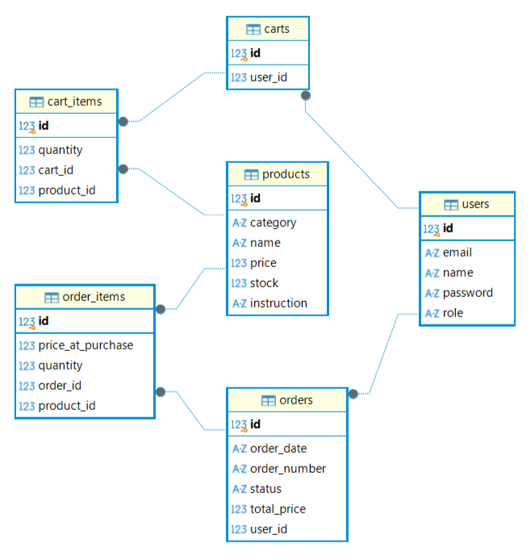
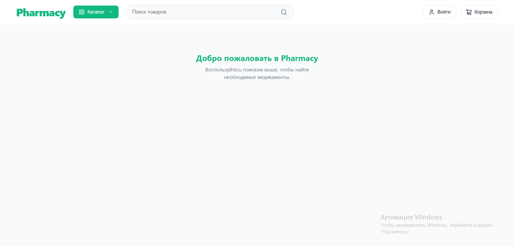
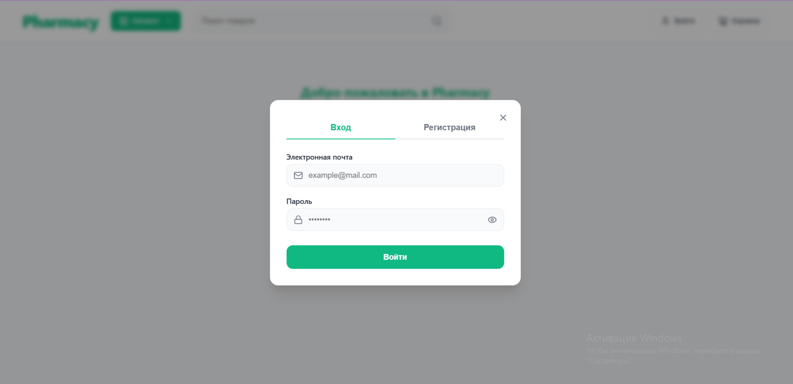
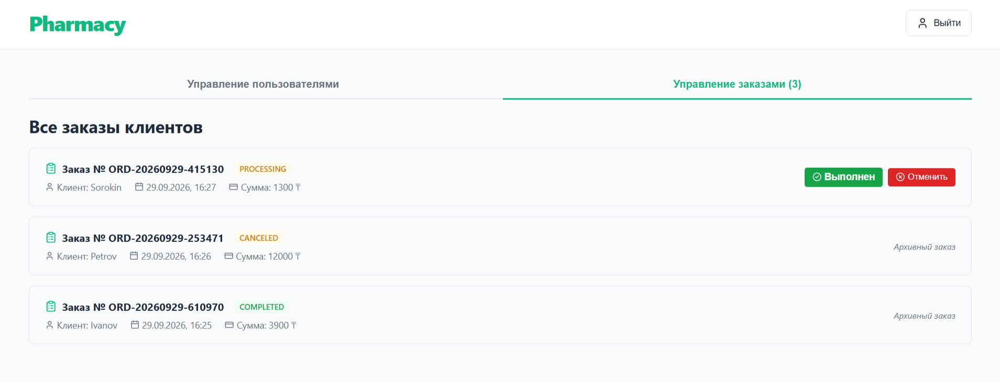
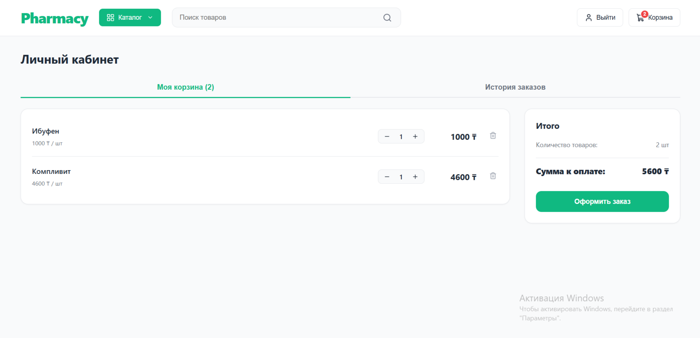
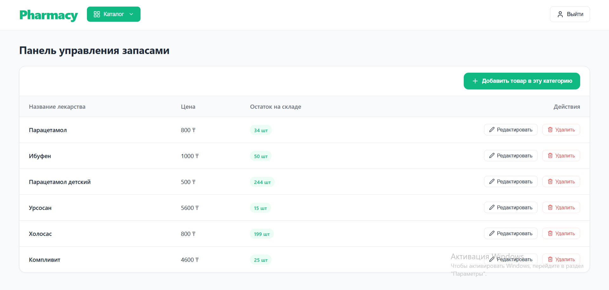

# Pharmacy Management System

A full-stack pharmacy web application built with Spring Boot and React. The application provides REST API endpoints for user authentication, product management, shopping cart operations and order processing, with role-based access control.

## Features

- User registration and authentication using JWT
- Role-based access control for CLIENT, ADMIN and PHARMACIST
- Product catalog with category filtering and search
- Shopping cart management
- Order creation and order status management
- User management for administrators
- Input validation and centralized exception handling
- Password hashing using BCrypt
- Application logging with Logback
- Automated tests for application components
- Docker-based deployment of the backend and frontend

## Tech Stack

### Backend
- Java
- Spring Boot
- Spring Web (REST API)
- Spring Data JPA / Hibernate
- Spring Security
- JWT authentication
- SQLite
- Jakarta Validation
- Lombok
- Logback
- Maven

### Frontend
- JavaScript
- React
- Vite
- HTML / CSS

### Testing
- JUnit 5
- Mockito
- Spring MVC Test / MockMvc

### DevOps and Tools
- Docker
- Docker Compose
- Nginx
- Git / GitHub
- IntelliJ IDEA

## Architecture

The application follows a layered backend architecture that separates HTTP request handling, business logic and data access.

The main backend layers are:

- **Controller** — handles HTTP requests and returns responses.
- **Service** — implements business logic and coordinates operations.
- **Repository** — provides database access through Spring Data JPA.
- **Entity** — represents persistent domain objects.
- **DTO** — defines data structures for API requests and responses.
- **Security** — handles authentication and authorization.
- **Validation and Exception Handling** — validates input and provides consistent error responses.

The frontend communicates with the backend through REST API endpoints.

The application uses JWT-based authentication and role-based authorization to restrict access to protected operations.

## Database

The application uses SQLite as its relational database, with Hibernate/JPA for persistence.

The database stores application data such as users, products, shopping cart items and orders.

For local development, the application uses `pharmacy.db` by default. In the Docker setup, the database is stored in `data/pharmacy.db` and persisted using a host directory mount.

The local development database and the Docker database are separate.

### Database Schema



## Docker Deployment

The application can be run using Docker Compose.

The Docker setup includes:

- A backend container running the Spring Boot application.
- A frontend container serving the React production build through Nginx.
- Nginx reverse proxy configuration for forwarding `/api/` requests to the backend.
- Persistent storage for the SQLite database.
- Environment-based configuration for the JWT secret.

### Run with Docker Compose

#### Prerequisites

- Docker Desktop
- Maven and a compatible JDK for building the backend JAR

#### 1. Configure environment variables

Create a `.env` file in the project root and configure the JWT secret:

```dotenv
JWT_SECRET=your_base64_encoded_secret
```

Use your own sufficiently strong secret. Do not commit the `.env` file to the repository.

#### 2. Build the backend JAR

From the project root, run:

```bash
mvn package -DskipTests
```

#### 3. Build and start the containers

```bash
docker compose up --build -d
```

#### 4. Open the application

Open the following URL in your browser:

http://localhost

The frontend is served by Nginx, which forwards API requests to the backend container.

#### 5. Stop the containers

```bash
docker compose stop
```

To start the stopped containers again:

```bash
docker compose start
```

To rebuild the images after making code changes, run:

```bash
docker compose up --build -d
```

## Local Development

### Backend

Run the Spring Boot application from IntelliJ IDEA or use Maven:

```bash
mvn spring-boot:run
```

Configure the required `JWT_SECRET` environment variable before starting the application.

By default, the backend runs on:

http://localhost:8080

### Frontend

Navigate to the frontend directory:

```bash
cd frontend
npm ci
npm run dev
```

Open the Vite development server at:

http://localhost:5173

The Vite development proxy forwards `/api` requests to the local backend.

## Testing

Run the backend tests with Maven:

```bash
mvn test
```

The project uses JUnit 5 and Mockito for automated testing, with MockMvc for controller-level testing.

## Security

- Passwords are hashed using BCrypt.
- JWT is used for authentication.
- Role-based authorization protects restricted operations.
- Sensitive configuration is supplied through environment variables rather than committed to source control.

## Screenshots

### Main page



### Login



### Admin page 



### Client page 



### Pharmacist page 



## What I Learned

While developing this project, I practiced:

- Building REST APIs with Spring Boot.
- Implementing authentication and authorization with Spring Security and JWT.
- Designing a layered application architecture.
- Working with JPA, Hibernate and SQLite.
- Implementing validation and centralized exception handling.
- Writing unit and controller tests with JUnit 5, Mockito and MockMvc.
- Integrating a React frontend with a Spring Boot backend.
- Configuring API proxies for local development.
- Containerizing a full-stack application with Docker and Docker Compose.
- Serving a production frontend with Nginx and configuring reverse proxy routing.
- Managing environment variables and persistent database storage.

## Author

ElenaV-dev — [GitHub Profile](https://github.com/ElenaV-dev)
